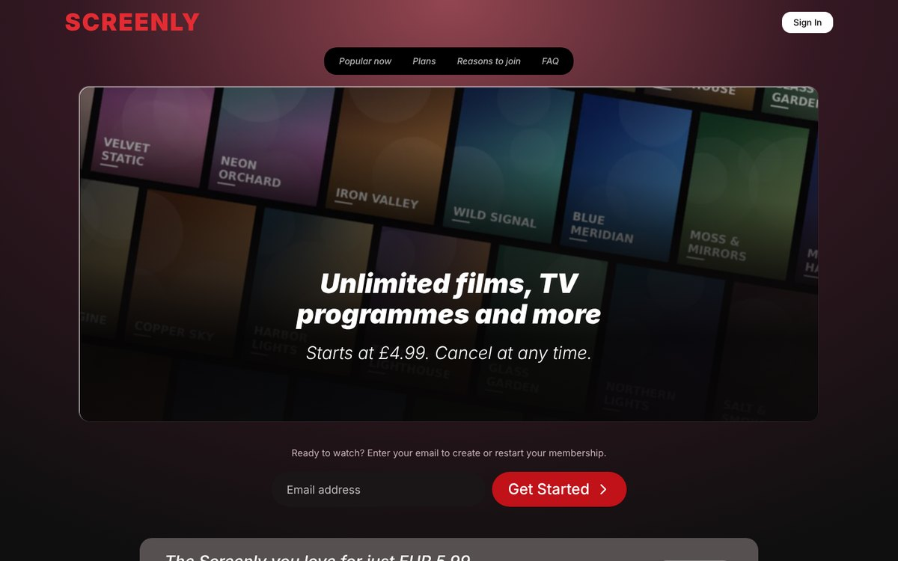
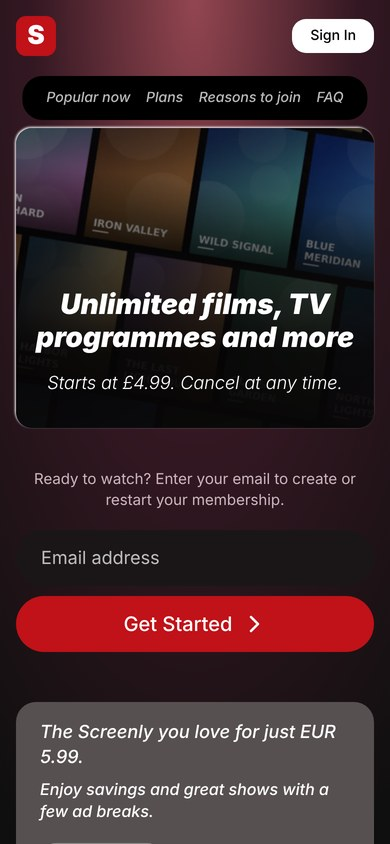

# Screenly: streaming landing page 🎬

A responsive landing page for a **fictional** streaming service, built with plain HTML, CSS and a little JavaScript (no frameworks). It started as a class exercise in recreating a real landing page. This version is rebuilt with a fluid layout, so it works on phones, tablets and desktops.

🔗 **[Live demo](https://hastinavabian.github.io/screenly-landing-page/)** <!-- update the link after enabling GitHub Pages -->

| Desktop | Mobile |
| --- | --- |
|  |  |

## What it shows

- **Fluid, mobile-first layout:** CSS Grid and Flexbox with `clamp()`, `min()` and media queries, no horizontal scrolling from 320px up
- **Sections:** fixed top bar and section nav, hero, email sign-up, promo banner, scrollable poster rows, pricing plans, reasons to join, FAQ and footer
- **Native, accessible components:** FAQ built with `<details>` / `<summary>` (no JavaScript), a real `<form>` with a visible `<label>` for screen readers, descriptive `alt` text, `:focus-visible` outlines, `aria-live` form messages
- **Small JavaScript:** email validation with an inline message (demo only: nothing is sent or stored)
- **Performance:** WebP images (about 5 KB per poster), lazy-loaded poster rows, system font stack (no font files to download)
- **Respects user settings:** `prefers-reduced-motion`

## About the content

Screenly is not a real service and is not affiliated with any streaming company. The posters and the hero image are placeholders generated with Python (Pillow) with invented titles, and all text is written for this demo.

## Tech

HTML5, CSS3 (Grid, Flexbox, custom properties, `clamp()`), JavaScript (ES6+).

## Project structure

```
├── index.html      # page markup
├── css/style.css   # all styles, including the tablet and phone layouts
├── js/main.js      # demo form validation
├── images/         # generated placeholder posters and hero image (WebP)
└── screenshots/
```

## Run locally

No installation or build step is needed. Open `index.html` in your browser.

## Ideas for the future

- A working carousel with arrow buttons and keyboard support for the poster rows
- A light theme with a toggle
- Language switch (English / French)
